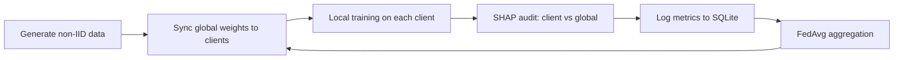

<div align="center">

# 🔬 Explainability in Federated Learning

### An XAI audit framework that tracks how client and global models *reason*, not just how accurate they are


</div>

---

## 📖 Overview

In federated learning (FL), clients train on their own private, **non-IID** data and a server averages their weights. Accuracy can look healthy while clients quietly learn *different explanations* for the same task.

This project runs a FedAvg simulation and **audits every round with SHAP**. It compares each client's feature attributions against the global model's and logs the drift to a persistent database, which you can explore in an interactive dashboard.

> **Core question:** do federated clients and the global model still rely on the same features as training progresses?

---

## ✨ Features

| Feature                          | Description                                                                         |
| -------------------------------- | ----------------------------------------------------------------------------------- |
| **Non-IID data partitioning**    | Dirichlet label-skew (β = 0.5) splits data unevenly across clients                  |
| **FedAvg training**              | PyTorch MLP clients with server-side weight averaging                               |
| **Per-round XAI auditing**       | SHAP `DeepExplainer` attributions for every client and the global model             |
| **Explainability drift metrics** | Cosine similarity and KL divergence between client and global attributions          |
| **Persistent audit trail**       | Client-level and global metrics stored in SQLite                                    |
| **Interactive dashboard**        | Streamlit + Plotly app for exploring convergence and drift                          |
| **Publication-ready plots**      | Convergence, drift, client consistency heatmap, and SHAP attribution figures        |

---

## 🧠 How It Works



**Each round:**

1. The server broadcasts the global weights to all clients.
2. The global model's SHAP importance vector is computed.
3. Each client trains locally (2 epochs, Adam, lr = 0.01) and computes its own SHAP importance vector.
4. The client vector is compared with the global one using **cosine similarity** and **KL divergence**.
5. Metrics and SHAP values are written to the database.
6. The server averages client weights (FedAvg) to produce the new global model.

### Setup details

| Component         | Configuration                                                                 |
| ----------------- | ----------------------------------------------------------------------------- |
| **Dataset**       | Synthetic binary classification, 2,000 samples, 10 features (8 informative, 2 redundant), standardized |
| **Partitioning**  | Dirichlet (β = 0.5) across 5 clients                                          |
| **Model**         | MLP: `10 → 32 → 16 → 2` with ReLU                                             |
| **Rounds**        | 15                                                                            |
| **Explainer**     | SHAP `DeepExplainer`, background = 100 reference samples                      |
| **Importance**    | Mean absolute SHAP value per feature (target class 1)                         |

### Drift metrics

| Metric                | What it measures                                                              | Reading it                    |
| --------------------- | ----------------------------------------------------------------------------- | ----------------------------- |
| **Cosine similarity** | Directional agreement between client and global feature-importance vectors   | Closer to **1** = consistent  |
| **KL divergence**     | Distance between softmax-normalized importance distributions                  | Closer to **0** = consistent  |

---

## 📊 Results

Final round (15 rounds, 5 clients):

| Metric                         |  Value |
| ------------------------------ | -----: |
| Mean client training accuracy  | 93.47% |
| Mean client training loss      | 0.1562 |
| Mean XAI cosine similarity     | 0.9124 |
| Mean XAI KL divergence         | 0.0111 |

Accuracy and loss are averaged over the clients' local training passes, and explainability agreement stays high even under non-IID data.

### Dashboard preview

<p align="center">
  
</p>

<details>
<summary><b>📈 View individual plots</b></summary>

<br>

| Convergence dynamics | Explainability drift |
| :------------------: | :------------------: |
|  |  |

| Client consistency heatmap | SHAP feature attribution |
| :------------------------: | :----------------------: |
|  |  |

</details>

---

## 🚀 Quick Start

### 1. Clone the repository

```bash
git clone https://github.com/<your-username>/explainability-fl.git
cd explainability-fl
```

### 2. Create a virtual environment (recommended)

**Windows**

```bash
python -m venv venv
venv\Scripts\activate
```

**macOS / Linux**

```bash
python -m venv venv
source venv/bin/activate
```

### 3. Install dependencies

```bash
pip install -r requirements.txt
```

### 4. Run the pipeline

```bash
python main.py
```

This runs 15 FL rounds and fills `federated_audit.db`. Expected output:

```
[+] Initializing Persistent Audit Database...
[+] Generating Non-IID Partitioned Data Distributions...
[+] Launching FL Protocol on Execution Unit: cpu
| Round 01/15 | Mean Acc: 0.8527 | XAI Cosine Consistency: 0.8246 |
...
```

### 5. Generate plots and launch the dashboard

```bash
python visualize.py
streamlit run app.py
```

> 💡 No database yet? The dashboard has a **"Run FL Benchmark Pipeline Now"** button that does steps 4 and 5 for you.

---

## 🗂️ Project Structure

```
explainability_FL/
├── main.py              # Orchestrates the FL rounds
├── client.py            # Local training + client-side SHAP
├── server.py            # FedAvg aggregation + per-round auditing
├── explainability.py    # SHAP, cosine similarity, KL divergence
├── data_pipeline.py     # Non-IID data generation
├── model.py             # MLP classifier
├── database.py          # SQLite logging
├── visualize.py         # Static plot generation
├── app.py               # Streamlit dashboard
├── requirements.txt
├── plots/               # Generated figures
└── results/             # Exported CSVs and audit summary
```

---

## 🗄️ Audit Database Schema

**`fl_metrics`**, one row per client per round

| Column              | Type     | Description                          |
| ------------------- | -------- | ------------------------------------ |
| `round`             | INTEGER  | FL round number                      |
| `client_id`         | INTEGER  | Client identifier                    |
| `train_loss`        | REAL     | Local training loss                  |
| `train_acc`         | REAL     | Local training accuracy              |
| `cosine_similarity` | REAL     | Client vs global attribution         |
| `kl_divergence`     | REAL     | Client vs global attribution         |
| `shap_values`       | TEXT     | JSON feature-importance vector       |
| `timestamp`         | DATETIME | Time of logging                      |

**`global_metrics`**, one row per round

| Column            | Type     | Description                       |
| ----------------- | -------- | --------------------------------- |
| `round`           | INTEGER  | FL round number                   |
| `avg_loss`        | REAL     | Mean client loss                  |
| `avg_acc`         | REAL     | Mean client accuracy              |
| `mean_cosine_sim` | REAL     | Mean cosine similarity            |
| `mean_kl_div`     | REAL     | Mean KL divergence                |
| `timestamp`       | DATETIME | Time of logging                   |

---

## ⚙️ Customization

Change the experiment in `main.py`:

```python
run_federated_pipeline(num_rounds=15, num_clients=5)
```

Tune data heterogeneity in `data_pipeline.py`. A **lower `beta`** gives more skewed (more non-IID) clients:

```python
generate_non_iid_data(num_clients=5, num_samples=2000, num_features=10, beta=0.5)
```

---

## 🛠️ Tech Stack

PyTorch · SHAP · scikit-learn · NumPy · SciPy · Pandas · Matplotlib · Seaborn · Streamlit · Plotly · SQLite

---

## 🔭 Future Work

- Real-world datasets (medical, tabular, image)
- Alternative aggregation strategies (FedProx, FedAdam)
- Additional explainers (LIME, Integrated Gradients)
- Drift-aware client weighting during aggregation

---

## 📄 License

Distributed under the MIT License. See `LICENSE` for details.

---

<div align="center">

⭐ If you find this project useful, consider giving it a star!

</div>
